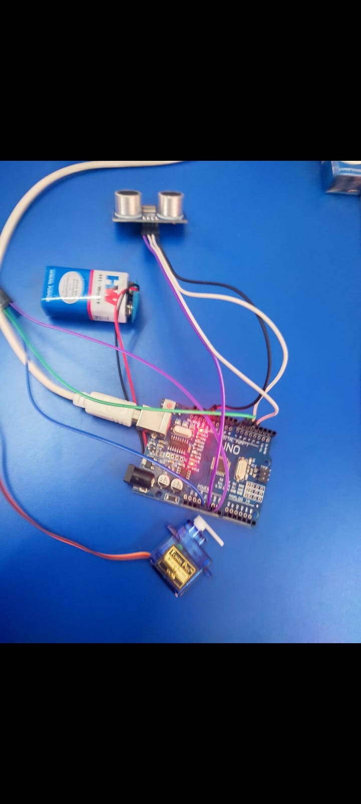
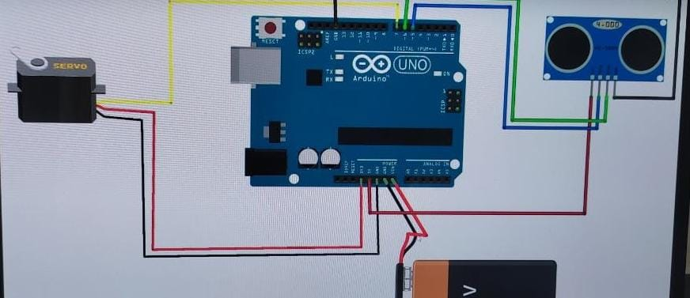

# Smart IoT Automated Railway Crossing & Gate Management System

An embedded IoT automation mechanism designed to prevent unmanned railway crossing collisions by autonomously detecting approaching trains via ultrasonic distance telemetry, controlling servo barriers, and deploying audiovisual alert signals.

---

## 🌟 Overview & Real-World Impact

Unmanned and manual level crossings represent one of the highest casualty zones in railway transport infrastructure. This system implements an automated safety interlock:
- **Instant Optical Sensing**: Ultrasonic time-of-flight telemetry detects trains independent of ambient light.
- **Moving Average Noise Suppression**: Triple-sample window filtering rejects airborne interference and spurious ultrasonic reflections.
- **Fail-Safe Barrier Control**: High-torque servo actuates physical barricade gates to halt road traffic prior to track clearance.
- **Audiovisual Alert Indicators**: Active LED/buzzer signal arrays warn approaching vehicles and pedestrians.

---

## 🛠️ Hardware Bill of Materials (BOM)

| Component | Specification | Quantity |
| :--- | :--- | :---: |
| **Microcontroller** | Arduino Uno / Nano (ATmega328P) | 1 |
| **Distance Sensor** | HC-SR04 Ultrasonic Sensor | 1 |
| **Actuator** | TowerPro SG90 / MG995 Servo Motor | 1 |
| **Warning Indicator** | High-Brightness Warning LED / Buzzer | 1 |
| **Power Supply** | 5V DC External / USB | 1 |
| **Prototyping** | Breadboard & Jumper Wire Harness | 1 |

---

## 🔌 Pinout & Circuit Schematic

| Arduino Pin | Connected Component | Function |
| :--- | :--- | :--- |
| **Pin 5** | HC-SR04 \TRIG\ | Ultrasonic Pulse Trigger |
| **Pin 6** | HC-SR04 \ECHO\ | Ultrasonic Echo Receiver |
| **Pin 7** | Servo Motor \PWM\ (Orange) | Barrier Angle Actuation |
| **Pin 10** | Warning LED \Anode\ | Visual Crossing Alert |
| **5V / GND** | Sensor & Servo Power Rails | System Power Ground Reference |

---

## 📸 Hardware Setup & Prototyping

| Physical Model Setup | Circuit Wiring Overview |
| :---: | :---: |
|  |  |

---

## 🚀 Getting Started

### Prerequisites
- [Arduino IDE](https://www.arduino.cc/en/software) (v2.0+ recommended)
- Arduino Servo Library (\Servo.h\ — built-in)

### Installation & Flashing
1. Clone the repository:
\\\ash
git clone https://github.com/ranvijay123987/smart-railway-gate.git
cd smart-railway-gate
\\\
2. Open \src/smart_railway_gate.ino\ in Arduino IDE.
3. Connect your Arduino board via USB.
4. Select the correct **Board** and **COM Port** in \Tools -> Board / Port\.
5. Click **Upload** (or press \Ctrl + U\).
6. Open Serial Monitor at **9600 baud** to view distance telemetry and gate status events in real time.

---

## 📄 License
This project is open-source and available under the MIT License.
